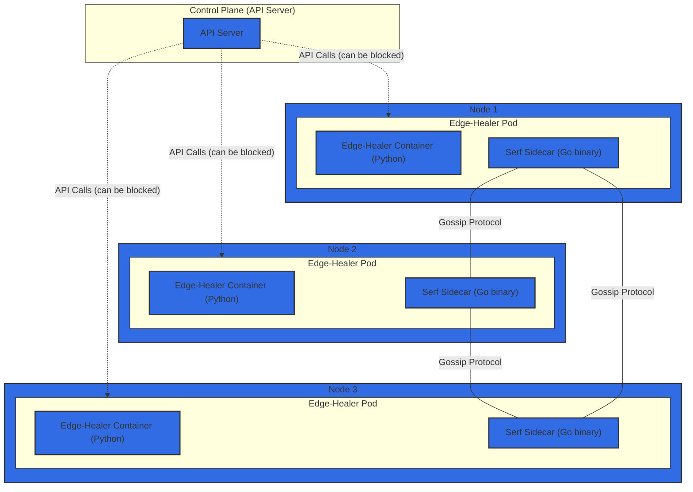
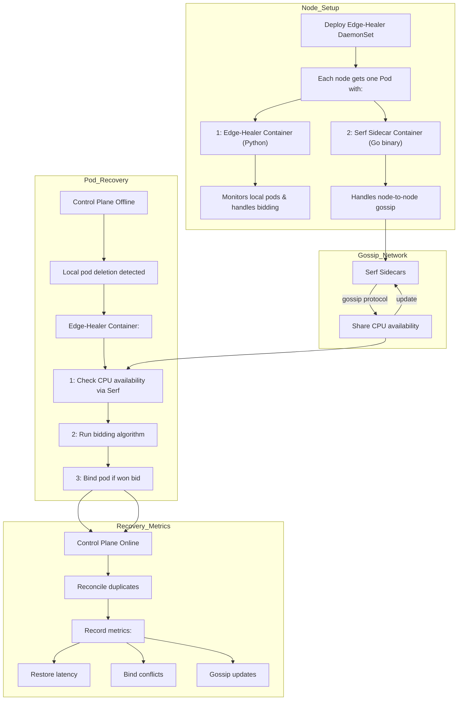

# Edge-Healer

A lightweight self-healing DaemonSet agent for Kubernetes edge clusters.  
Whenever the control-plane (API server) becomes unavailable, the agent gossips liveness & free-capacity among peers, caches desired ReplicaSet specs locally, and optimistically re-binds missing Pods on the healthiest survivor node. When the WAN link returns, it reconciles duplicates to prevent split-brain.

**Website:** <https://dlamagna.github.io/kubernetes-edge-healer/>: a write-up, the paper and poster, and an interactive demo of the experiment.

---

## Features

- **Serf-based gossip** (via python-serfclient) for peer health and free-CPU exchanges  
- **Kopf operator** (async) to watch Pods & ReplicaSets  
- **Optimistic patch /binding** to restore deleted Pods in ≤ 0.3 s  
- **SQLite cache** of desired ReplicaSet state for cold-boot offline recovery  
- **Prometheus metrics** (restore latency histogram, bind conflicts, gossip updates)  

---

## Architecture

### Node-Level Architecture



### System Flow



## Repository Layout

```
.
├── src/                          # the agent (built into the edge-healer image)
│   ├── main.py                   # Kopf operator entrypoint: Pod/ReplicaSet handlers, offline check
│   ├── scheduler.py              # bid_and_bind: bidding + optimistic /binding
│   ├── gossip.py                 # SerfGossip: free-CPU gossip through the Serf sidecar
│   ├── cache.py                  # SQLite DesiredStateCache of ReplicaSet specs
│   ├── metrics.py                # Prometheus metrics + HTTP server (:8000)
│   ├── Dockerfile
│   └── requirements.txt          # runtime dependencies
├── config/
│   ├── rbac.yaml                 # ServiceAccount, ClusterRole, ClusterRoleBinding
│   ├── daemonset.yaml            # DaemonSet: healer container + Serf sidecar
│   └── service-metrics.yaml      # NodePort Service for the metrics (:30080)
├── demo/
│   ├── busybox-spread.yaml       # test workload: 3 replicas, spread one per node
│   ├── measure_latency.py        # restore latency with a WAN outage (standalone)
│   ├── test_outage.py            # outage vs normal restart, with histograms
│   └── test_metrics.py           # quick check of the metrics endpoint
├── scripts/
│   ├── setup-edge-healer.sh      # one-shot setup: KinD cluster, image, RBAC, DaemonSet, workload
│   ├── update-docker-image.sh    # rebuild the image, reload it, restart the DaemonSet
│   ├── cut-out-wan.sh            # block the API server (iptables DROP on :6443)
│   ├── internal-pod-deletion.sh  # remove a busybox-spread Pod's containers from inside a node (crictl)
│   ├── delete-replica-set.sh     # delete the busybox-spread ReplicaSet
│   ├── tail-healer-logs.sh       # follow the healer logs
│   └── build-site.sh             # build the project website (see "Website")
├── tests/                        # pytest unit + integration tests
├── site/                         # project website (GitHub Pages)
├── requirements.txt              # test and demo-script dependencies
├── lamagna_edge_healer_final.pdf # paper
└── lamagna_edge_healer_poster.pdf
```

---

## Prerequisites

- `docker`, [`kind`][kind] and `kubectl` (client and server within one minor version of each other: `kubectl version`)
- Python 3.11+ for the tests and the scripts in `demo/`

[kind]: https://kind.sigs.k8s.io/

All the scripts use a KinD cluster named **`serf-demo`** and the image **`edge-healer:latest`**.

---

## Quick start

From the repository root:

```bash
scripts/setup-edge-healer.sh
```

It creates (or reuses) the `serf-demo` cluster with one control plane and three workers, builds `edge-healer:latest` from `src/`, loads it into the cluster, applies `config/rbac.yaml`, `config/daemonset.yaml` and `config/service-metrics.yaml`, waits for the rollout and deploys `demo/busybox-spread.yaml`.

Check it:

```bash
kubectl -n kube-system get pods -l app=edge-healer -o wide   # one per node, 2/2 Running
kubectl get pods -l app=busybox-spread -o wide               # one replica per worker
```

The DaemonSet tolerates every taint, so an edge-healer Pod runs on the control-plane node too.

### The same steps by hand

```bash
cat <<'KIND' | kind create cluster --name serf-demo --config=-
kind: Cluster
apiVersion: kind.x-k8s.io/v1alpha4
nodes:
  - role: control-plane
  - role: worker
  - role: worker
  - role: worker
KIND

docker build -t edge-healer:latest src/
kind load docker-image edge-healer:latest --name serf-demo

kubectl apply -f config/rbac.yaml -f config/daemonset.yaml -f config/service-metrics.yaml
kubectl -n kube-system rollout status ds/edge-healer
kubectl apply -f demo/busybox-spread.yaml
```

### After changing the code

```bash
scripts/update-docker-image.sh   # rebuild, kind load, re-apply the DaemonSet, rollout restart
```

---

## Test healing

### Online (control plane reachable)

```bash
kubectl delete pod $(kubectl get pod -l app=busybox-spread -o name | head -1) --grace-period=0 --force
kubectl -n kube-system logs ds/edge-healer -c healer --since=10s | grep -E "POD GONE|skipping"
```

Every agent sees the deletion, finds the API server reachable (`is_offline() → False`) and leaves the recreation to the ReplicaSet controller.

### Offline (control plane unreachable)

With KinD, a worker's traffic to the API server goes over the Docker network, so block it **inside the node** (here `serf-demo-worker2`), then remove a Pod's containers there with `scripts/internal-pod-deletion.sh`:

```bash
docker exec serf-demo-worker2 iptables -I OUTPUT -p tcp --dport 6443 -j DROP

docker cp scripts/internal-pod-deletion.sh serf-demo-worker2:internal-pod-deletion.sh
docker exec serf-demo-worker2 bash -c 'chmod +x internal-pod-deletion.sh && ./internal-pod-deletion.sh'

# the node can't reach the API, so read the healer log on the node itself
docker exec serf-demo-worker2 sh -c 'tail -n 200 /var/log/pods/kube-system_edge-healer-*/healer/0.log' | grep -E "POD GONE|offline|bid"

# restore the API
docker exec serf-demo-worker2 iptables -D OUTPUT -p tcp --dport 6443 -j DROP
```

`scripts/cut-out-wan.sh` applies the same kind of `iptables` rule on the machine it runs on: it looks up the API server's address with `kubectl` and drops traffic to it on port 6443. Use it where that machine actually sits on the path to the API server. Its last line (commented out) restores access.

See [Known issues](#known-issues) before reading too much into the offline results.

### Other helpers

```bash
scripts/tail-healer-logs.sh      # follow the healer logs
scripts/delete-replica-set.sh    # delete the busybox-spread ReplicaSet (exercises the ReplicaSet cache)
```

---

## Metrics & Monitoring

Each agent serves Prometheus metrics on port 8000 of its node (`hostNetwork: true`):

* `restore_latency_seconds`: time taken to restore a Pod (histogram)
* `bind_conflicts_total`: `/binding` attempts rejected because another node won
* `peer_updates_total`: free-CPU gossip updates received

```bash
NODE_IP=$(kubectl get node serf-demo-worker2 -o jsonpath='{.status.addresses[?(@.type=="InternalIP")].address}')
curl -s http://$NODE_IP:8000/metrics | grep -E 'restore_latency|bind_conflicts|peer_updates'
```

The NodePort Service from `config/service-metrics.yaml` (applied by the setup script) exposes the same endpoint on port 30080 of any node.

### Scripts in `demo/`

`measure_latency.py`, `test_outage.py` and `test_metrics.py` measure restore latency and read the metrics from outside the cluster. Their addresses are hard-coded in the `CONFIG` block at the top of each file (e.g. `NODE_IP = "172.20.0.4"`, `API_SERVER = "10.96.0.1"`): set them to your cluster's values first (`kubectl get nodes -o wide`). Install their dependencies with `pip install -r requirements.txt`.

---

## Running Tests

The tests import the agent as `src.*`, while the agent's own modules import each other by bare name (they run from inside `src/` in the container), so both directories must be on the path:

```bash
python3 -m venv .venv && source .venv/bin/activate
pip install -r requirements.txt -r src/requirements.txt "setuptools<81"   # serfclient still imports pkg_resources
PYTHONPATH=.:src pytest tests/
PYTHONPATH=.:src pytest tests/unit/          # unit tests only
PYTHONPATH=.:src pytest --cov=src tests/     # with coverage
```

The suite is out of date with the code: currently 2 of the 7 tests pass (see [Known issues](#known-issues)).

---

## Known issues

Checked on 2026-10-13 by running the steps above on KinD v0.29.0 (Kubernetes v1.33), with the latest versions of the unpinned Python dependencies:

- **The gossip ring does not form.** The Serf sidecars are started without `-join`, so `serf members` on each node lists only itself. The healer's gossip loop also fails with `'SerfClient' object does not support the context manager protocol` (`serfclient` is not pinned in `src/requirements.txt`, so this may depend on the version installed), and nothing calls `SerfGossip.broadcast_free_cpu`. As a result every agent logs `Current peer CPU map: {}` and `peer_updates_total` stays at 0.
- **The offline test does not reach edge-healer.** `internal-pod-deletion.sh` removes the Pod's containers with `crictl`, but the Pod object still exists, so the kubelet simply restarts the container in place. No delete event is produced, and in any case Kopf receives its events through the API server, which the node can no longer reach. Detecting a loss offline needs a node-local source of events (the kubelet / CRI) instead of the API watch.
- **The healer container restarted once** while its node's API access was blocked.
- **Tests:** 5 of 7 fail (non-awaitable mocks in the unit test, names that no longer exist in the integration tests).
- The `crictl` binary in `src/Dockerfile` is downloaded for `amd64`; on an `arm64` host it is installed but cannot run (the agent does not need it).

---

## Website

The project website lives in `site/` (plain HTML, CSS and JavaScript, no build tools) and is deployed to GitHub Pages by `.github/workflows/pages.yml` on every push to `main` that touches it. To preview it locally:

```bash
scripts/build-site.sh                      # site/ + the paper and poster PDFs -> dist/site
python3 -m http.server -d dist/site 8080   # then open http://localhost:8080/
```

One-off setting for the repository owner: *Settings > Pages > Build and deployment > Source:* **GitHub Actions**.

---

## Advanced Topics and Future work

* **Peer-TTL pruning**: drop Serf peers idle > 2 s
* **Cold-boot replay**: restore missing Pods on startup if offline
* **Split-brain reconciliation**: delete duplicates when control-plane returns
* **uvloop integration**: add `uvloop.install()` in `main.py` for lower latency
* **Unit tests**: use `pytest-asyncio` and mocks for bidding logic
* **Packaging**: Helm chart or Kustomize overlay

